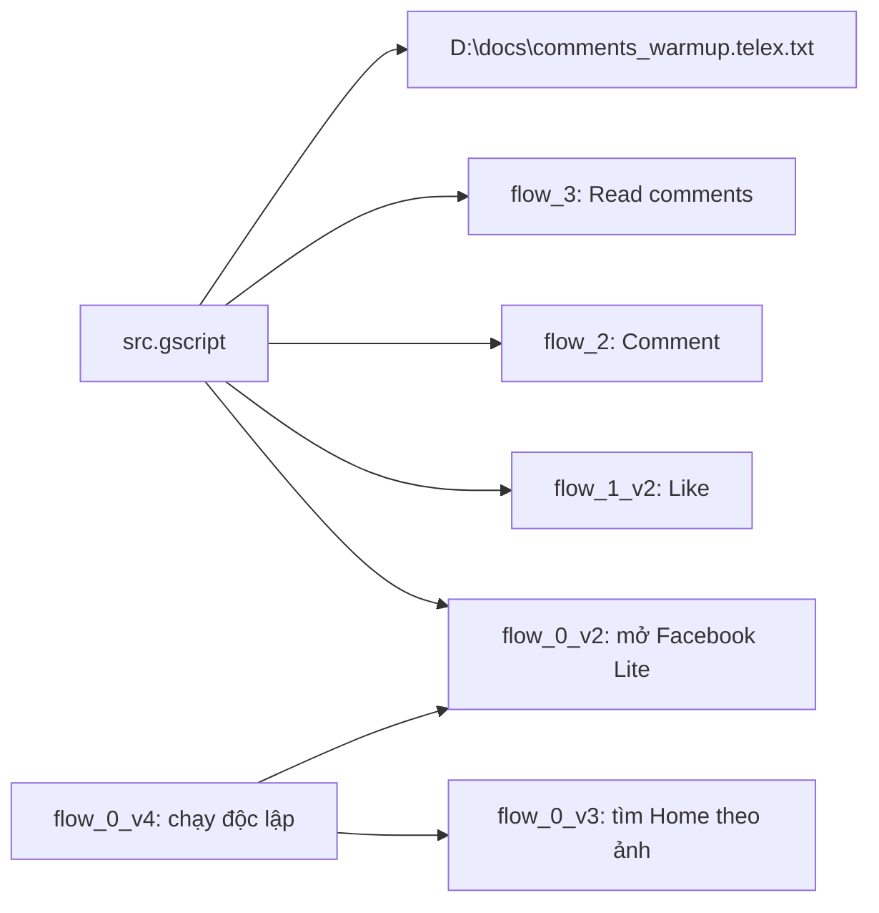

# Kết nối và ranh giới runtime — Box_v1

## Thành phần local

| Thành phần | Vị trí | Vai trò |
| --- | --- | --- |
| Project | `D:\gpm\Box_v1` | Source GPM Automate Phone và asset Image Search. |
| GPM Editor | `C:\Users\phudinh\AppData\Local\Programs\GPMAutomate\Editor\GPMAutomateEditor.exe` | Soạn workflow, import asset và test node. |
| GPM Runtime | `C:\Users\phudinh\AppData\Local\Programs\GPMAutomate\Runtime\GPMAutomateRuntime.exe` | Chạy Phone workflow trên phone mà người vận hành chọn. |
| Pool comment | `D:\docs\comments_warmup.telex.txt` | Nguồn dòng comment Telex được Main cấp cho `flow_2`. |
| Bộ chuyển Telex | `D:\gpm\Box_v1\tools\Convert-CommentsToTelex.ps1` | Sinh pool Telex ASCII từ file tiếng Việt. |

## Luồng dữ liệu

Main không dùng Excel input hiện tại. Phone Runtime đã giữ `$inputExcel[B]` như văn bản thay vì resolve đường dẫn, nên `flow_2` đọc trực tiếp từ `$commentsPath` do Main đặt. Không bật “Map according to the profile name in column A” chỉ để cấp CommentPath cho workflow này.

## GPM Phone và BoxPhone V3

GPM Phone và BoxPhone V3 là hai runtime khác nhau. Không chạy đồng thời trên cùng một phone. Appium UiAutomator2 của BoxPhone V3 chỉ phù hợp khi cần quan sát hoặc xác minh UI theo đúng quyền được cấp; GPM UI Automator do người vận hành dùng để dò XPath/ảnh trong Editor.

Không coi XPath native hay Image Search là bằng chứng semantic như HTML DOM. Image Search phụ thuộc độ phân giải, theme, tỷ lệ hiển thị và phiên bản Facebook Lite hiện tại.

## Ranh giới thiết bị và mạng

Mapping device, user Android, serial, proxy và trạng thái Appium là thông tin động. Xác minh lại trước canary. Không dùng tài liệu này làm uỷ quyền để mở app, chạm màn hình, đổi mạng/proxy, thay dữ liệu hoặc thực hiện lệnh ADB trên thiết bị thật.

## Mở project và kiểm tra source

1. Mở thư mục `D:\gpm\Box_v1` trong GPM Automate Editor.
2. Đảm bảo asset `img_3` đến `img_9` còn trong project.
3. Sau khi Codex sửa file, đóng/mở lại Editor trước khi Test/Run.
4. Đọc log Runtime; `✓` trước node chỉ cho biết node chạy được. Với Image/Has element, đọc biến output để biết có tìm thấy hay không.