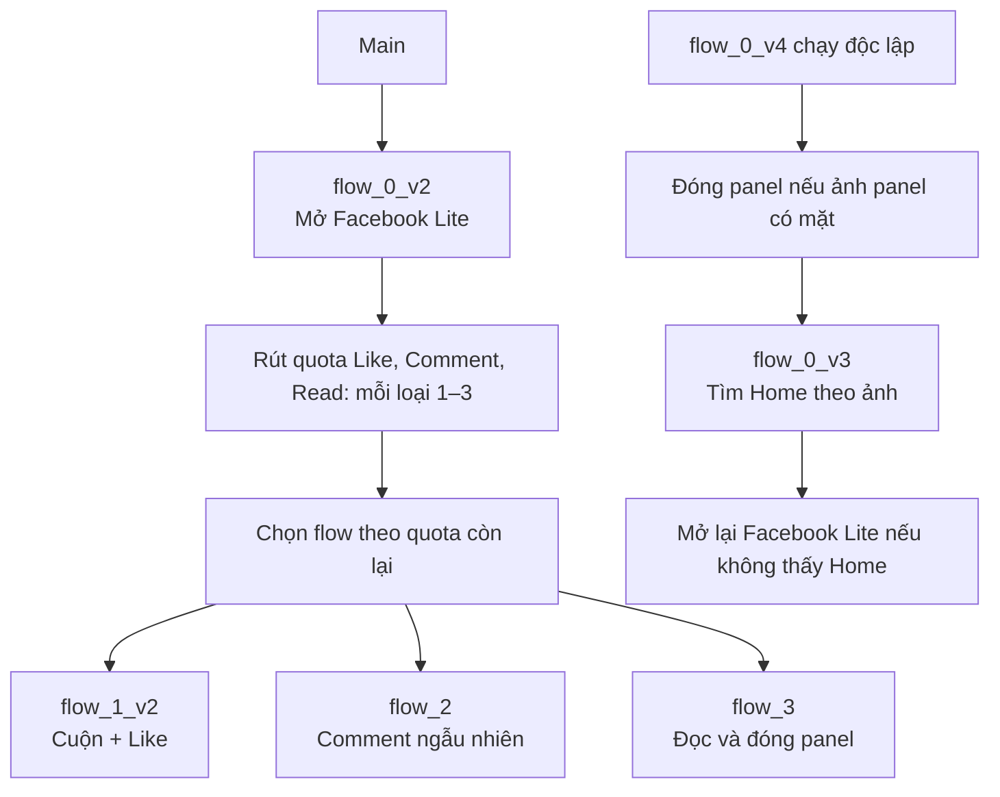

# Phone Action Runbook — Box_v1

Tài liệu này mô tả **source hiện tại** trong `D:\gpm\Box_v1` và tách riêng bằng chứng Runtime đã có với phần chỉ mới kiểm tra tĩnh. Nó không là uỷ quyền để thực hiện thao tác trên phone, proxy, tài khoản hoặc mạng.

## 1. Phạm vi và quy ước

| Nội dung | Quy ước hiện tại |
| --- | --- |
| App | Facebook Lite: `com.facebook.lite`. |
| Độ phân giải đã dùng để tạo gesture | 1440×2960. |
| Image Search | Threshold `0.8`, `TRUE_COLOR=No`; kết quả là chuỗi `x,y` hoặc rỗng. |
| Touch theo ảnh | Chỉ thực hiện trong điều kiện `$position != ""`. |
| Dữ liệu comment | Pool Telex ASCII: `D:\docs\comments_warmup.telex.txt`. |
| Main | `src.gscript`; gọi `flow_0_v2`, `flow_1_v2`, `flow_2`, `flow_3`. |
| Recovery | `flow_0_v4` chạy độc lập; Main không tự gọi recovery. |

Dấu `✓` trước Phone action nghĩa là Runtime đã thực thi node. Giá trị biến output mới quyết định ảnh/XPath có tìm thấy hay không. Ví dụ `PhoneHasElement ✓` kèm `$homeExists = false` là node chạy được nhưng không có element khớp selector.

## 2. Sơ đồ workflow



Main tính `totalFlows = remainingFlow1 + remainingFlow2 + remainingFlow3`, sau đó chọn một slot trong tổng quota còn lại ở mỗi vòng. Vì vậy quota thực tế không phụ thuộc thứ tự gọi flow.

## 3. Asset ảnh

| File | Vai trò | Flow |
| --- | --- | --- |
| `img_3.img64` | Like chưa bấm | `flow_1_v2` |
| `img_4.img64` | Liked | `flow_1_v2` |
| `img_5.img64` | Nút Comment | `flow_2`, `flow_3` |
| `img_6.img64` | Verify panel comment / vùng focus input | `flow_2`, `flow_3`, `flow_0_v4` |
| `img_7.img64` | Send comment | `flow_2` |
| `img_8.img64` | Verify comment đã đăng | `flow_2` |
| `img_9.img64` | Home Facebook Lite, import từ `D:\capture\symbol_home.png` | `flow_0_v3` |

`img_1` và `img_2` là asset lịch sử; không có workflow Main hiện tại tham chiếu. Khi Facebook Lite, theme hoặc scale thay đổi, tạo lại crop và canary từng ảnh trước khi chạy Main.

## 4. Flow khởi động và recovery

### `flow_0_v2` — mở Facebook Lite

1. `PhoneStartApp` với package `com.facebook.lite`.
2. `PhoneWaitElement` chờ root layout trong tối đa 20 giây.
3. Delay ngẫu nhiên 1.5–2.5 giây.

### `flow_0_v3` — Home theo ảnh

1. `Image Search img_9` → `$homePos`.
2. Nếu `$homePos != ""`: ghi `HOME_ICON_FOUND`, touch `$homePos`, đợi 5 giây.
3. Nếu rỗng: ghi `HOME_ICON_NOT_FOUND`.

Không dùng XPath Home cũ nữa: canary XPath đã trả `false` dù action `PhoneHasElement` chạy thành công.

### `flow_0_v4` — recovery độc lập

1. Kiểm tra `img_6` để biết panel comment có mặt.
2. Nếu có: swipe từ `720,450` tới `720,1750`, duration 650 ms; đợi 600–800 ms; kiểm tra lại `img_6`.
3. Chỉ tiếp tục navigation nếu ảnh panel không còn hoặc panel vốn không có.
4. Gọi `flow_0_v3`.
5. Nếu `HOME_ICON_NOT_FOUND`: bấm Android `Home`, chờ 800–1200 ms, gọi `flow_0_v2`, ghi `RECOVERY_REOPENED_FACEBOOK`.
6. Nếu Home Facebook đã được touch: ghi `RECOVERY_HOME_RESET`.

Nếu ảnh panel vẫn còn sau swipe, ghi `RECOVERY_PANEL_STILL_OPEN` và không điều hướng tiếp.

## 5. Flow Like — `flow_1_v2`

1. Đặt `scrollTimes = 5`.
2. Mỗi lượt random điểm kéo: x `520..920`, y đầu `2350..2550`, y cuối `1150..1350`, duration `450..700` ms; scroll xong chờ 1.2–1.8 giây.
3. Chờ feed 1.5–3 giây.
4. Random `actionRoll` trong `1..2`. Điều kiện hiện tại là `1 <= actionRoll <= 2`, vì vậy Action A chạy ở mọi lần gọi flow.
5. Tìm `img_3` → `$likePos`. Nếu rỗng, ghi `LIKE_ICON_NOT_FOUND`.
6. Nếu có vị trí: touch Like, chờ 5 giây, kiểm tra `img_4`.
7. Ghi `LIKE_CONFIRMED` hoặc `LIKE_NOT_CONFIRMED`.

Nếu mục tiêu sau này là chỉ Like với xác suất 2/9 như bản thiết kế cũ, cần đổi source `actionRoll` về `1..9`; tài liệu này ghi đúng source hiện tại, không tự đổi logic.

## 6. Flow Comment — `flow_2`

`flow_2` độc lập, không gọi `flow_3`.

1. Random `$commentRandom` từ `1..9`.
2. Nếu khác `1`, ghi `COMMENT_SKIPPED_BY_RANDOM` rồi kết thúc.
3. Nếu bằng `1`, `FileReadRandomLine` lấy `$commentContent` từ `$commentsPath` do Main đặt.
4. Cuộn feed ba lần với tọa độ random cùng dải của `flow_1_v2`.
5. Tìm `img_5`; nếu rỗng ghi `COMMENT_ICON_NOT_FOUND`.
6. Touch Comment, chờ 3–4 giây, verify `img_6`.
7. Nếu panel verified: tìm lại `img_6` lấy `$commentPanelPos`, touch để focus, chờ 3 giây.
8. `PhoneTypeText` vào XPath `//node[@text="Write a comment…"]`, dùng `$commentContent`, giữa ký tự 20–50 ms.
9. Chờ 3 giây, tìm `img_7`. Nếu không thấy ghi `COMMENT_SEND_BUTTON_NOT_FOUND` và giữ panel mở để kiểm tra.
10. Nếu thấy: touch Send, chờ 5–7 giây, kiểm tra `img_8`.
11. Ghi `COMMENT_POST_VERIFIED` hoặc `COMMENT_POST_NOT_VERIFIED`.

Khi không thấy `img_6` hoặc không lấy được vị trí focus, flow ghi trạng thái lỗi và giữ panel mở theo chính sách quan sát thủ công.

### Pool Telex

`PhoneTypeText` với Unicode tiếng Việt trực tiếp từng gây lỗi/biến dạng do Gboard. Workflow dùng nội dung Telex ASCII và Gboard Vietnamese Telex. Dùng script sau để tạo pool:

```cmd
powershell -NoProfile -File "D:\gpm\Box_v1\tools\Convert-CommentsToTelex.ps1" -InputPath "D:\docs\comments_warmup.txt"
```

Phone Clipboard đã được thử và không dán ổn định vào input comment; không dùng Clipboard trong `flow_2` hiện tại.

Phone Runtime không resolve `$inputExcel[B]` trong `FileReadRandomLine`, nên workflow không lấy `CommentPath` từ Excel. Không cấu hình Excel mapping cho mục đích này cho đến khi Runtime hỗ trợ resolve biến đó.

## 7. Flow đọc comment — `flow_3`

1. Cuộn feed ba lần bằng tọa độ random.
2. Chờ 1.5–3 giây, tìm `img_5` và touch nếu có.
3. Chờ 3–4 giây, verify `img_6`.
4. Nếu verified: cuộn nhỏ trong panel hai lần; x `520..880`, y đầu `1750..2050`, y cuối `1400..1650`, duration `350..550` ms.
5. Swipe xuống để đóng panel, chờ 600–800 ms, kiểm tra lại `img_6`.
6. Ghi `COMMENT_PANEL_CLOSED` hoặc `COMMENT_PANEL_STILL_OPEN`.
7. Nếu verify panel ban đầu là `false` sau khi đã touch Comment: vẫn swipe xuống và chờ 600–800 ms, ghi `COMMENT_PANEL_VERIFY_NOT_FOUND_FALLBACK_SWIPE_SENT`.

Trạng thái fallback chỉ xác nhận lệnh swipe đã được gửi. Nó không chứng minh panel đã biến mất, vì cùng ảnh `img_6` vừa không tìm thấy ở bước verify đầu.

## 8. Biến trạng thái và giới hạn

| Biến | Ý nghĩa |
| --- | --- |
| `$mainResult` | `MAIN_WORKFLOW_QUOTA_COMPLETED` sau khi Main gọi xong toàn bộ quota. |
| `$likeResult` | `LIKE_CONFIRMED`, `LIKE_NOT_CONFIRMED`, hoặc `LIKE_ICON_NOT_FOUND`. |
| `$flow2Result` | Trạng thái skip, tìm panel/input/Send hoặc verify comment của `flow_2`. |
| `$flow3Result` | Trạng thái không thấy Comment/panel, đóng panel, hoặc fallback swipe của `flow_3`. |
| `$homeResult` | `HOME_ICON_FOUND` hoặc `HOME_ICON_NOT_FOUND`. |
| `$recoveryResult` | `RECOVERY_PANEL_STILL_OPEN`, `RECOVERY_HOME_RESET`, hoặc `RECOVERY_REOPENED_FACEBOOK`. |
| `$flowRunStatus` | Log nội bộ của flow con. Không dùng làm điều kiện auto-recovery ở Main. |

Phone Runtime log cho thấy flow con có thể ghi `$flowRunStatus = OK` nhưng Main vẫn thấy trạng thái trước đó sau `Call workflow`. Auto-recovery theo biến này đã bị tắt để tránh reset Facebook sau flow thành công.

## 9. Bằng chứng và việc cần canary

| Hạng mục | Trạng thái |
| --- | --- |
| Gửi comment bằng Telex | Người vận hành đã test thành công. |
| Verify post-comment `img_8` | Người vận hành đã test thành công. |
| `PhonePressKey Home` trong recovery | Log Runtime đã thực thi node thành công. |
| XPath Home cũ | Không ổn định; log trả `$homeExists = false`. Đã thay bằng `img_9`. |
| `flow_3` fallback swipe khi verify panel false | Source đã kiểm tra JSON/cấu trúc; chưa có log canary riêng sau khi thêm. |
| `flow_0_v3` Home theo `img_9` | Asset và JSON đã kiểm tra; cần canary Runtime sau thay XPath. |

## 10. Checklist test và commit

Trước Test/Run:

1. Đóng/mở lại Editor để nạp source mới.
2. Xác nhận asset ảnh đúng giao diện hiện tại.
3. Test riêng các flow mới thay đổi: `flow_0_v3`, `flow_3` fallback và `flow_0_v4`.
4. Đọc output biến; đừng suy ra “đã tìm thấy” chỉ vì action có dấu `✓`.
5. Nếu Image Search trả rỗng, không sửa bằng tọa độ cứng; cập nhật crop/threshold sau canary.

Trước commit:

```powershell
Get-ChildItem -LiteralPath 'D:\gpm\Box_v1' -Filter '*.gscript' |
  ForEach-Object { Get-Content -Raw $_.FullName | ConvertFrom-Json | Out-Null }
git -C D:\gpm\Box_v1 diff --check
git -C D:\gpm\Box_v1 status --short
```

Không commit `.gpmconfig`, `.gpmlaunch`, screenshot tạm, nội dung comment riêng tư, token, mật khẩu hoặc dữ liệu thiết bị.